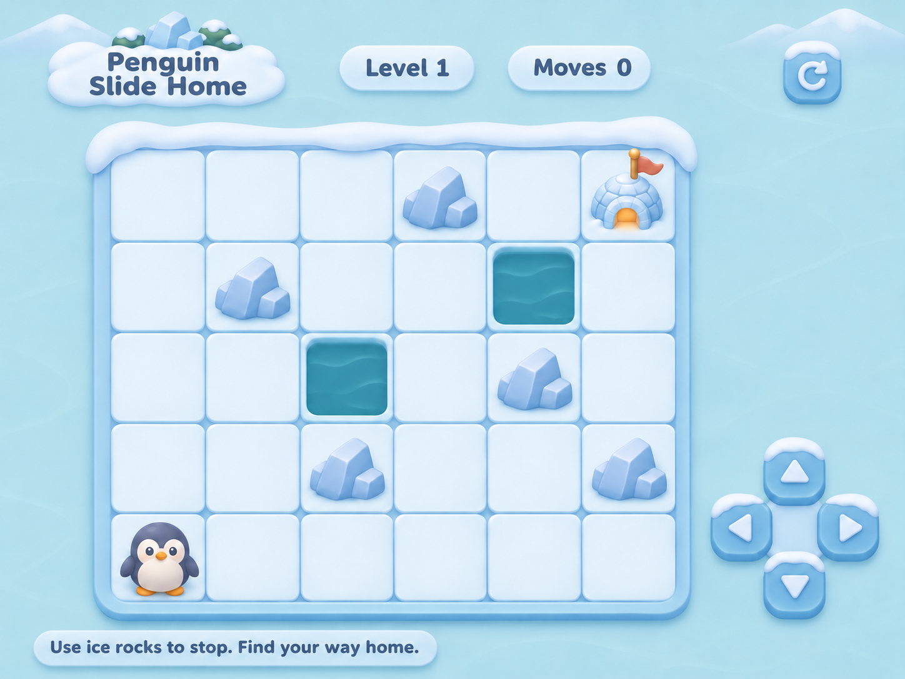

# Penguin Home Journey

企鹅滑冰回家：一款采用 XGo/spx 制作、面向 XBuilder 的格子滑行解谜游戏。

玩家选择一个方向，小企鹅持续直线滑行，借助冰岩停下、转向，最终到达温暖的雪屋。游戏内文字使用英文。

## 当前进度

第一阶段：游戏设定、美术方向和原始素材归档。**尚未实现可运行游戏，尚未生成 .xbp 工程包，也未导入或发布到 XBuilder。**

- [游戏设定 v0.1](docs/game-design-v0.1.md)
- [美术与素材说明](docs/art-direction.md)
- [阶段记录和后续步骤](docs/progress.md)
- [素材校验清单](assets/manifest.json)
- [协作约定](AGENTS.md)

## 已确认的视觉方向

这是一张美术概念图，不是游戏截图，图中的关卡尚未验证有解。它只用于参考配色、造型和布局。

## 制作流程

游戏设定 → 阅读 XBuilder 当前规范 → Codex 编辑原生 XGo/spx 工程 → 逻辑与资源验证 → 打包 .xbp → 导入用户自己的 XBuilder 项目适配 → 获得发布授权后发布 → 回存最终版本。

每个阶段先说明具体成果与拟写入内容，得到用户同意后才写入或提交。GitHub 和 XBuilder 不假定自动同步。

## 参考来源

- [Slider Escape 官方介绍](https://www.flipline.com/blog/archives/7945)：参考四方向滑动解谜玩法；本项目自行设计角色主题、关卡和工程。
- [XBuilder](https://github.com/goplus/builder) / [spx](https://github.com/goplus/spx)：工程规范和运行能力参考。
- [同事的 Go Lita 项目](https://github.com/wenjiangping/1024-JP)：仅参考制作、管理、打包和验收流程，不修改或复制其游戏素材。

用户提供的美术原图与本次生成的预览分别归档，未声明全仓库统一素材授权；具体来源见素材清单。
