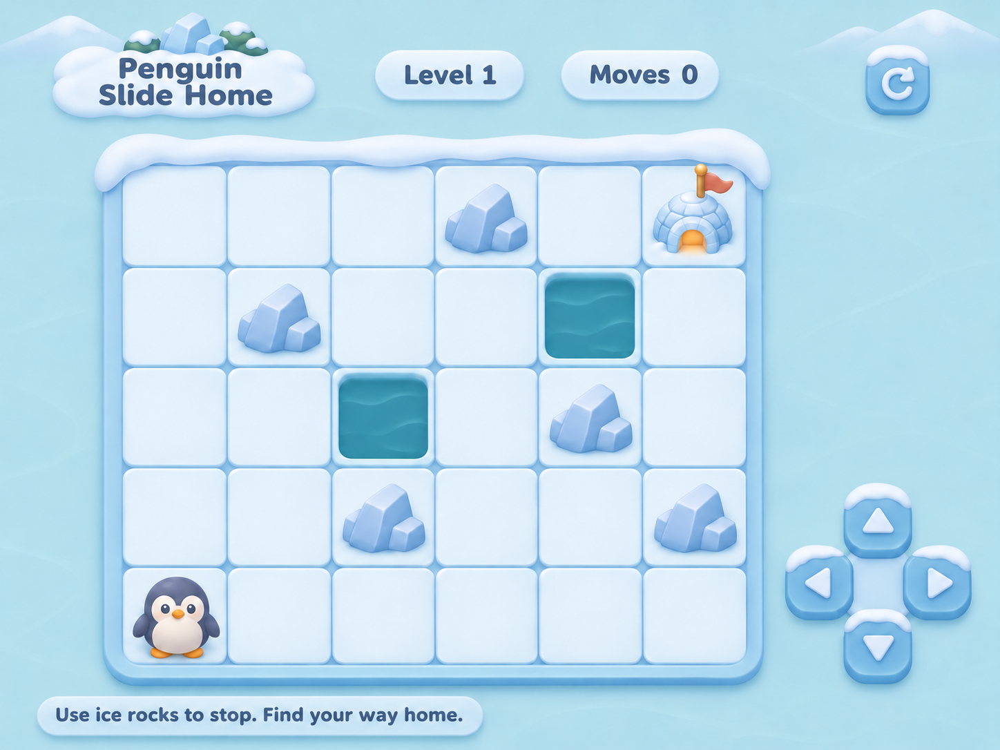
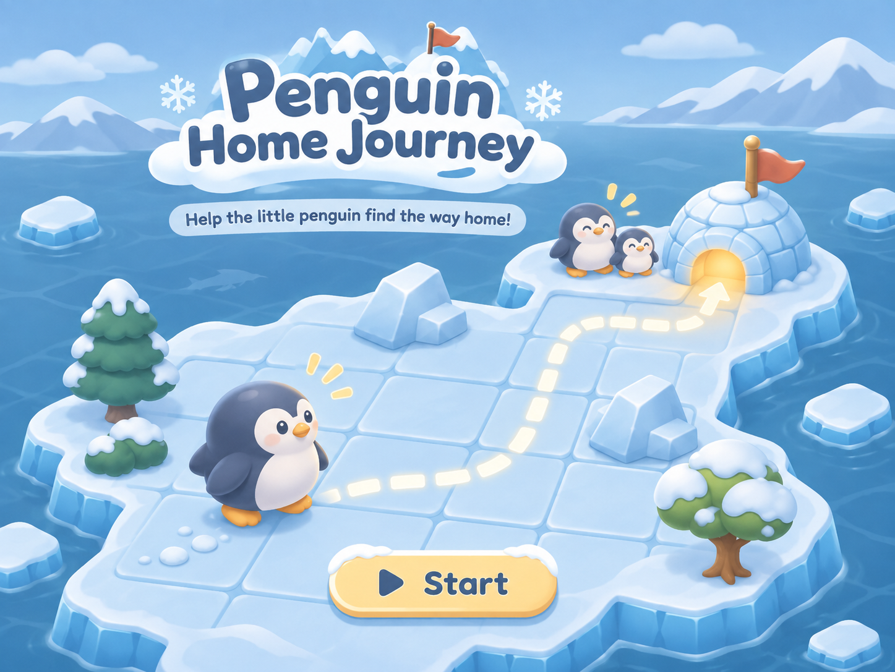

# 美术方向与素材

## 已确认方向

用户认可浅色预览的配色和整体风格，并要求所有游戏文字改为英文。采用柔和浅青蓝背景、近雪白冰面、淡蓝紫冰岩、深蓝紫企鹅和奶油金色强调。降低原始海水及 UI 的高饱和蓝色和荧光边缘。

预览由内置 imagegen 根据用户素材生成，属于视觉草案，不是运行截图。标题 Penguin Slide Home 是旧工作名，以最新封面的 Penguin Home Journey 为准。

## 用户最新首页素材

- 首页保留用户最新封面的构图和风格。其自带标题、副标题、路径、角色和 Start 图案。
- 独立 Start 素材具有透明通道，适合成为可交互按钮，但不能与封面内的 Start 重复叠出两套图案。
- 后续可将封面内按钮处理掉再放独立按钮，或先让封面内按钮位置成为准确的点击区域；具体接入方案在代码阶段审阅。当前不修改原图。
- 首页插画的路线、树和冰岛装饰不构成实际关卡规则。游戏棋盘保持正交，不照搬插画的透视布局。

## 素材清单

全部原图由用户于 2026-11-07 提供；不改变原始字节，仅在仓库中使用稳定英文文件名。尺寸、SHA-256、原文件名及使用状态见 [manifest.json](../assets/manifest.json)。

| 文件 | 用途 | 后续处理 |
| --- | --- | --- |
| source/penguin-directions.png | 四朝向主角 | 拆分四张造型，统一脚底锚点和视觉尺寸 |
| source/ice-tile.png | 冰面 | 降低高光，统一格子边缘和拼接 |
| source/ice-rock.png | 冰岩障碍 | 调整为柔和蓝紫，控制单格占用 |
| source/water-tile.png | 海水 | 降低饱和度，仍需明显区别于安全冰面 |
| source/igloo-goal.png | 家园终点 | 保留暖黄入口，适度柔化旗帜及描边 |
| source/penguin-family.png | 家人 | 用于首页或结算装饰，避免干扰地图判定 |
| source/ocean-background.png | 原始背景 | 作为参考；后续按已确认浅色方向制作运行背景 |
| source/ice-ui-sheet.png | 界面素材参考 | 按需拆分并柔化；计步文字应运行时生成 |
| source/start-button.png | 首页按钮 | 与封面内按钮统一位置及点击范围 |
| source/cover.png | 首页封面 | 保留原图，运行版本另存 |
| references/gameplay-preview-en.png | 美术预览 | 不作为整张可交互游戏画面，不继承未经验证的地图 |

## 可读性要求

- 安全冰面、冰岩、海水三个类别必须一眼区分。背景浅不等于危险格也变得近白。
- 玩家与终点最醒目；少量奶油金色用于 Start 和家门口，不额外引入彩色道具。
- UI 不覆盖地图。立体冰岩和雪屋不能遮挡相邻格。
- 棋盘外围不可画成明显实体护栏，否则会误导玩家认为边缘能刹车。
- PNG 带 alpha 通道仅说明格式支持透明；切图后需检查实际透明边缘和缩小后的残边。
- 原始素材与派生运行素材分开保存，不覆盖用户 Downloads 中的文件。

## 来源与授权记录

用户提供了图片文件，尚未附单独授权文档。清单如实标为 user-provided，不虚构作者、素材许可或对所有图片统一声明开源授权。生成的英文预览标为 imagegen-preview。运行素材来源逐项记录。
